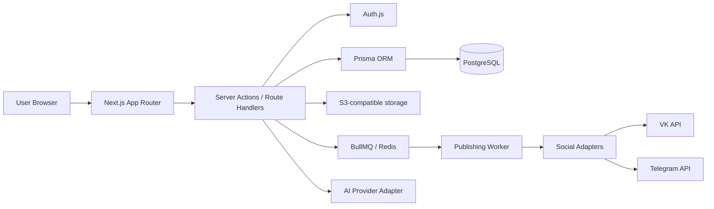
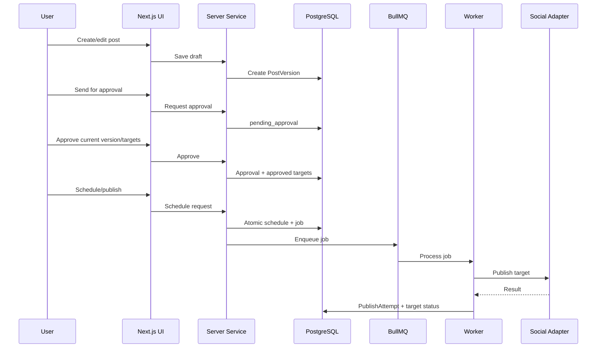

# Архитектура целевой SaaS-платформы управления соцсетями

Документ относится к этапу 1: исследование, технический план, архитектура и
карта маршрутов. Код приложения на этом этапе не изменяется.

## 1. Текущее состояние репозитория

В репозитории уже есть Python/FastAPI mock MVP:

- backend: FastAPI;
- БД: SQLite через SQLAlchemy;
- HTML: Jinja templates;
- тесты: pytest;
- mock-функции: AI-генерация, публикация, Ozon import, Telegram notifications.

Целевой продукт из `AGENTS.md` требует другой стек:

- Next.js App Router;
- React;
- TypeScript strict mode;
- Tailwind CSS;
- shadcn/ui;
- PostgreSQL;
- Prisma ORM;
- Auth.js или Supabase Auth;
- серверная бизнес-логика, очереди публикаций и модульная SaaS-архитектура.

Вывод: текущий FastAPI MVP можно использовать как функциональный прототип и
источник бизнес-инвариантов, но целевую SaaS-платформу нужно проектировать как
новое Next.js-приложение. Переносить текущий код напрямую не рекомендуется.

## 2. Целевые архитектурные принципы

1. Multi-tenant модель: все пользовательские данные изолированы по workspace.
2. Серверная проверка прав на каждом действии.
3. UI не содержит бизнес-логики публикации.
4. Публикация идёт через единый интерфейс social adapter.
5. Approval относится к конкретной версии контента и набору целей публикации.
6. Очереди публикаций идемпотентны и защищены от повторной отправки.
7. Интеграции без credentials показывают статус настройки, а не фиктивный успех.
8. AI-ключи и OAuth-токены никогда не попадают в frontend.
9. Секреты хранятся только серверно и шифруются на уровне приложения или БД.
10. Все даты хранятся в UTC и отображаются в часовом поясе пользователя.

## 3. Целевой стек

| Область | Решение | Обоснование |
|---|---|---|
| Frontend/backend | Next.js App Router | Единый full-stack фреймворк |
| Язык | TypeScript strict | Типобезопасность |
| UI | Tailwind CSS + shadcn/ui | Быстрая дизайн-система |
| Формы | React Hook Form + Zod | Валидация client/server |
| БД | PostgreSQL | Надёжная реляционная multi-tenant модель |
| ORM | Prisma | Миграции и типизированный доступ |
| Auth | Auth.js | Email/password, sessions, extensibility |
| Очереди | Redis + BullMQ | Планировщик и публикации |
| Хранилище | S3-compatible storage | Медиатека |
| Графики | Recharts | Аналитика |
| Unit tests | Vitest | Модульные тесты TS |
| E2E tests | Playwright | Проверка пользовательских сценариев |
| Dev environment | Docker Compose | PostgreSQL/Redis/S3/email локально |

## 4. Высокоуровневая схема



## 5. Модули

### Marketing Website

Публичные страницы продукта: главная, возможности, тарифы, FAQ, блог, документы,
контакты, вход и регистрация.

### Authentication

Регистрация, подтверждение email, вход, выход, восстановление пароля, управление
сессиями, создание workspace при регистрации.

### Workspace Management

Рабочие пространства, участники, роли, приглашения, права доступа.

### Projects

Проекты внутри workspace, настройки проекта, архивирование, связь с аккаунтами и
публикациями.

### Social Account Integrations

Подключения через официальные API/OAuth. Каждая интеграция реализует общий
адаптер возможностей, публикации и проверки результата.

### Content Editor

Черновики, версии, предпросмотр, цели публикации, согласование, расписание.

### Media Library

Загрузка, проверка MIME, хранение в S3, миниатюры, папки, привязка к публикациям.

### Content Calendar

Месяц/неделя/день/список, фильтры, перенос дат, статусы публикаций.

### Publishing Engine

Планировщик, очередь, обработчик публикаций, попытки, статусы PostTarget,
идемпотентность и ручная проверка неопределённых результатов.

### AI Content Assistant

Генерация идей, постов, заголовков, CTA, хештегов, адаптаций под платформы,
история запросов, лимиты и учёт использования.

### Analytics

Нормализованные и исходные метрики по платформам, периодам, проектам и аккаунтам.

### Team Collaboration

Комментарии, approval, роли Owner/Admin/Editor/Approver/Viewer, уведомления.

### Subscription and Billing

Тарифы, лимиты, payment provider interface, webhook verification, usage records.

### Administration

Защищённая админка сервиса: пользователи, workspaces, тарифы, интеграции, очереди,
ошибки, audit.

## 6. Карта маршрутов

### Публичный сайт

| Route | Назначение |
|---|---|
| `/` | Главная |
| `/features` | Все возможности |
| `/features/autoposting` | Автопостинг |
| `/features/ai-assistant` | AI-ассистент |
| `/features/analytics` | Аналитика |
| `/features/content-editor` | Редактор контента |
| `/features/media-library` | Медиатека |
| `/features/team` | Командная работа |
| `/pricing` | Тарифы |
| `/faq` | FAQ |
| `/blog` | Блог |
| `/blog/[slug]` | Статья |
| `/help` | Справочный центр |
| `/contacts` | Контакты |
| `/privacy` | Политика конфиденциальности |
| `/terms` | Пользовательское соглашение |

### Авторизация

| Route | Назначение |
|---|---|
| `/login` | Вход |
| `/register` | Регистрация |
| `/verify-email` | Подтверждение email |
| `/forgot-password` | Запрос восстановления |
| `/reset-password` | Сброс пароля |

### Личный кабинет

| Route | Назначение |
|---|---|
| `/app` | Обзор |
| `/app/calendar` | Календарь |
| `/app/posts` | Публикации |
| `/app/posts/new` | Новый пост |
| `/app/posts/[id]` | Редактор публикации |
| `/app/ai` | AI-ассистент |
| `/app/media` | Медиатека |
| `/app/social-accounts` | Социальные аккаунты |
| `/app/analytics` | Аналитика |
| `/app/projects` | Проекты |
| `/app/team` | Команда |
| `/app/subscription` | Подписка |
| `/app/notifications` | Уведомления |
| `/app/settings` | Настройки |

### Администрирование

| Route | Назначение |
|---|---|
| `/admin` | Обзор |
| `/admin/users` | Пользователи |
| `/admin/workspaces` | Workspaces |
| `/admin/plans` | Тарифы |
| `/admin/integrations` | Интеграции |
| `/admin/queues` | Очереди |
| `/admin/audit` | Audit log |

### API / route handlers

| Route | Назначение |
|---|---|
| `/api/auth/*` | Auth.js endpoints |
| `/api/workspaces` | Workspaces |
| `/api/projects` | Projects |
| `/api/social-accounts` | Social accounts |
| `/api/posts` | Posts |
| `/api/calendar` | Calendar data |
| `/api/media` | Media upload/list |
| `/api/ai` | AI requests |
| `/api/analytics` | Analytics |
| `/api/team` | Team and invitations |
| `/api/subscription` | Subscription state |
| `/api/webhooks/billing` | Billing webhooks |
| `/api/webhooks/social/[platform]` | Social callbacks/webhooks |

## 7. Модель данных

Минимальная Prisma-модель должна включать следующие сущности.

### Identity and tenancy

- `User`
- `Workspace`
- `WorkspaceMember`
- `Invitation`
- `AuditLog`

Ключевые ограничения:

- `WorkspaceMember(workspaceId, userId)` уникален;
- email пользователя уникален;
- все workspace-scoped операции проверяют membership и роль.

### Projects and integrations

- `Project`
- `SocialAccount`
- `SocialAccountCapability`

Ключевые ограничения:

- проект принадлежит workspace;
- social account принадлежит workspace и может быть связан с project;
- OAuth/token fields шифруются;
- capability хранит поддержанные операции конкретного аккаунта.

### Content and publishing

- `Post`
- `PostVersion`
- `PostTarget`
- `PostMedia`
- `Approval`
- `Comment`
- `Schedule`
- `PublishJob`
- `PublishAttempt`

Статусы `Post`:

```text
draft
pending_approval
approved
scheduled
queued
publishing
published
failed
cancelled
```

Статусы `PostTarget`:

```text
draft
pending_approval
approved
scheduled
queued
publishing
published
failed
cancelled
requires_manual_check
```

Инварианты:

- approval относится к `PostVersion` и набору `PostTarget`;
- изменение значимого контента создаёт новую версию и инвалидирует approval;
- повторять можно только неуспешные targets;
- successful targets нельзя отправлять повторно;
- job имеет idempotency key;
- неопределённый результат переводится в `requires_manual_check`.

### Media

- `MediaAsset`
- `PostMedia`

Ограничения:

- файлы хранятся в S3-compatible storage;
- БД хранит metadata и storage key;
- MIME и размер проверяются сервером.

### AI

- `AIRequest`
- `UsageRecord`

Ограничения:

- provider key хранится серверно;
- запросы лимитируются по тарифу;
- результаты можно переносить в редактор публикаций.

### Analytics

- `AnalyticsSnapshot`

Ограничения:

- хранить normalized metrics и raw platform payload;
- фиксировать source, collectedAt, periodStart, periodEnd;
- не все метрики доступны для всех платформ.

### Billing

- `Subscription`
- `PaymentEvent`
- `UsageRecord`

Ограничения:

- платный статус подтверждается webhook или серверной проверкой;
- webhook events идемпотентны;
- лимиты проверяются атомарно.

### Notifications and administration

- `Notification`
- `AdminRole`

Ограничения:

- критические admin actions пишутся в `AuditLog`;
- доступ к admin routes проверяется серверно.

## 8. Поток публикации



## 9. Необходимые внешние сервисы

| Сервис | Назначение | Этап |
|---|---|---|
| PostgreSQL | Основная БД | 3 |
| Redis | Очереди публикаций, rate limits | 7 |
| S3-compatible storage | Медиатека | 5 |
| Email provider/dev mail | Email verification/password reset/invites | 3 |
| VK API credentials | Первая реальная социнтеграция, если подтверждена | 8 |
| Telegram Bot API credentials | Уведомления/публикации при подтверждении требований | 8+ |
| AI provider API key | AI assistant | 9 |
| Billing provider | Подписки и webhooks | 12 |
| Monitoring/logging | Ошибки, audit, очереди | 14 |

## 10. Минимальный вертикальный срез

Первый полностью рабочий срез:

```text
Регистрация
-> подтверждение email в dev-mail режиме
-> автоматическое создание workspace
-> создание проекта
-> подключение демонстрационного social account со статусом "требуется настройка"
-> создание черновика публикации
-> версия публикации
-> отправка на согласование
-> approval владельцем
-> постановка в расписание
-> создание PublishJob
-> worker обрабатывает job
-> adapter возвращает "integration_not_configured"
-> target получает failed/requires_manual_check
-> попытка и audit log сохраняются
```

Этот срез проверяет auth, tenancy, проекты, редактор, approval, расписание,
очередь, адаптеры, журналирование и UX ошибок без ложных внешних публикаций.

